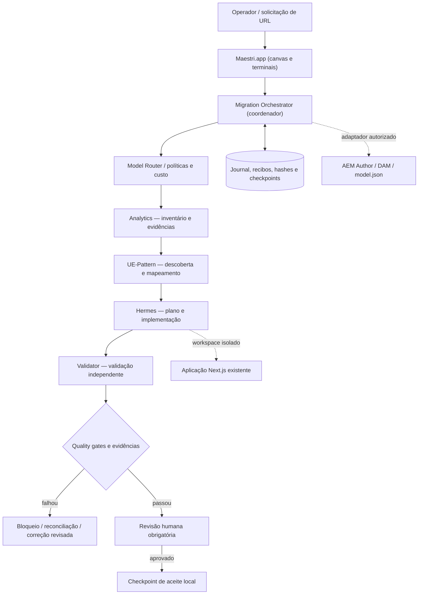
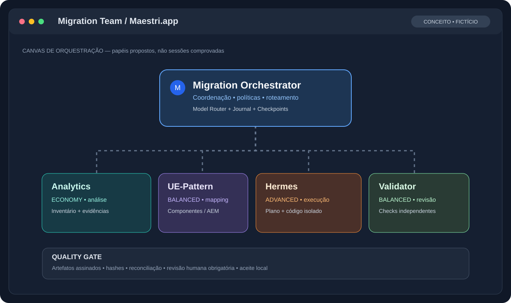

# Migration Maestro — visão geral, arquitetura e integrações

> Documentação pública e independente de clientes. Os nomes, URLs e telas abaixo são **exemplos fictícios**. Nenhum workspace real, sessão, credencial ou implantação é criado por este guia.

## Propósito

O **Migration Maestro** é um orquestrador local para planejar, executar e auditar migrações de páginas legadas para uma aplicação **React/Next.js** com conteúdo gerenciado no **Adobe Experience Manager (AEM)**. O objetivo é **reutilizar componentes existentes**, reduzir tarefas repetitivas, controlar custos e manter evidências verificáveis, checkpoints e revisão humana. O Maestri.app é a interface visual prevista para organizar os papéis; o código deste repositório implementa o coordenador e as integrações locais.

O projeto distingue três coisas: **código implementado**, **teste sintético** e **integração real homologada**. Testes unitários ou uma mensagem ACK não demonstram execução real. Um agente sem sessão e capacidade verificadas não recebe tarefas automaticamente. Escritas externas e publicação exigem autorização própria.

## Arquitetura



Fluxo lógico: **ANALYZE → DISCOVER_COMPONENTS → MAP_COMPONENTS → PLAN → IMPLEMENT → VALIDATE → REVIEW**. Os fluxos de integração AEM/DAM adicionam etapas próprias e gates de escrita create-only; não são automaticamente liberados pelo piloto sintético.

## Canvas conceitual do Maestri.app



A imagem é um **mockup ilustrativo**, não uma captura do aplicativo nem prova de que terminais, conexões, modelos ou contas estejam ativos. Os papéis versionados estão em `.maestri/maestro/role.json` e `.maestri/roles/`. Importar os papéis **não cria** sessões ou autoriza o uso de ferramentas.

## Preparação local

```bash
nvm use
npm ci
npm run check
npm test
npm run build
```

Use Node conforme `.nvmrc`. Não versione tokens, cookies, sessões, conteúdo de clientes, arquivos `.env`, diretórios locais de execução ou políticas específicas da máquina.

## Integração 1 — Maestri.app

1. Abra um workspace local apontando para o repositório.
2. Importe os papéis de `.maestri/maestro/role.json` e `.maestri/roles/{analytics,ue-pattern,hermes,validator}/role.json` pela interface de papéis disponível na sua versão do Maestri.
3. Associe o coordenador **Migration Orchestrator** ao terminal principal e os quatro especialistas aos terminais correspondentes.
4. Confirme as sessões existentes e suas capacidades por interfaces oficiais. A CLI `maestri list` só funciona quando o terminal tem acesso IPC autorizado.
5. Execute `npm run model-router:inspect` para obter diagnóstico de roteamento. Um modelo declarado em JSON não prova disponibilidade, identidade ou entitlement.
6. Valide comunicação e artefatos num job **sintético** antes de tentar integrar um projeto real.

A topologia proposta aparece no mockup. A disposição visual efetiva do canvas e os modelos ativos devem ser conferidos dentro do aplicativo. Consulte [configuração de modelos](maestri-model-setup.md) e [interface do Maestri](maestri-primary-interface.md).

## Integração 2 — fontes legadas e análise

Configure uma URL pública de teste autorizada, por exemplo `https://example.com/page`. O estágio Analytics coleta inventário e evidências; o UE-Pattern identifica correspondências no catálogo de componentes. Não use conteúdo confidencial como fixture pública. O intake disponível é:

```bash
npm run autopilot:intake -- "Migre esta URL: https://example.com/page"
```

Esse comando registra e tenta encaminhar a solicitação ao fluxo local configurado; pode permanecer bloqueado por falta de autenticação, sessões ou permissões. Não confunda registro de solicitação com migração concluída.

## Integração 3 — Next.js e catálogo de componentes

A aplicação de destino é um **checkout externo configurado pelo operador**, não um caminho fixo deste repositório. O catálogo considera componentes React, resource types, mappers/exporters e contratos de `model.json`. O Hermes só pode trabalhar no workspace/branch explicitamente autorizado, preservando mudanças existentes. O Validation Gate deve conferir TypeScript, testes, build, SSR, contratos e, quando disponível, evidências de navegador.

Para testar sem aplicativo real:

```bash
npm run maestro:operate -- next new --confirm-synthetic --pause-after-plan
npm run maestro:operate -- status
```

Após revisar o plano e instalar as dependências no `project/` isolado conforme [OPERATIONS.md](../OPERATIONS.md), retome o mesmo job. Esse teste não autoriza push, merge ou deploy.

## Integração 4 — AEM Author e DAM

Use somente um Author **local e autorizado**, com URL e credenciais fornecidas pelo operador via ambiente seguro. Exemplo genérico de URL: `http://localhost:4502/sites.html/content/example-site`. As operações de leitura são separadas das de criação. Antes de qualquer criação, verifique ausência do destino, registre intenção e preserve recibos para reconciliação após timeout. Não sobrescreva páginas/assets nem publique automaticamente.

Consulte [leitura local do AEM](aem-local-readonly-integration.md), [execução local](local-execution.md) e [contratos mapper/exporter](mapper-exporter-contracts.md). Não copie URLs internas ou credenciais para Markdown público.

## Integração 5 — runtimes Codex / Claude

O Native Runtime prevê transportes oficiais para Codex App Server e Claude Agent SDK, com registro de sessão, prova de capacidade, política de roteamento, claims, recibos e epoch fencing. **Driver implementado não equivale a provider autenticado ou qualificado**. A instalação local, as chaves Ed25519 e o arquivo de configuração ficam fora do Git. Não faça ativação transacional ou migração de instalação legada sem o procedimento supervisionado e os gates documentados em [runtime do Migration Team](migration-team-runtime.md).

## Operação, recuperação e revisão

```bash
npm run maestro:operate -- pipeline new --confirm-synthetic --pause-after-plan
npm run maestro:operate -- status
npm run maestro:operate -- resume <job-id> --confirm-synthetic
```

A retomada usa o **mesmo job**. Timeout de envio significa resultado desconhecido; não reenvie a tarefa para outro agente. Checkpoints são verificados por hash, e o resultado só é aceito após inspeção e aprovação humana. A aprovação local **não** faz publicação ou merge.

Documentação complementar: [arquitetura](../ARCHITECTURE.md), [operação](../OPERATIONS.md), [manutenção](../MAINTENANCE.md), [recuperação](../TROUBLESHOOTING.md).

## Estado e limitações

Este guia descreve a **arquitetura pretendida e os componentes implementados**, não uma certificação de produção. A comunicação com sessões reais, a disponibilidade de modelos, o acesso AEM, a validação visual e a segurança de uma atualização de runtime precisam de evidências independentes antes da habilitação. Não use o mockup para inferir que um fluxo foi executado.
