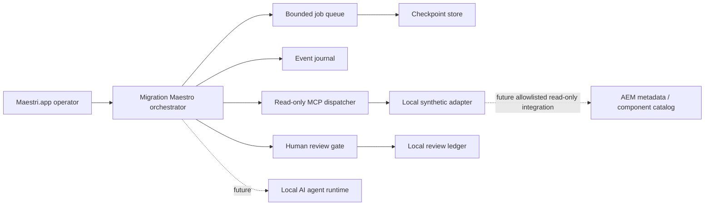
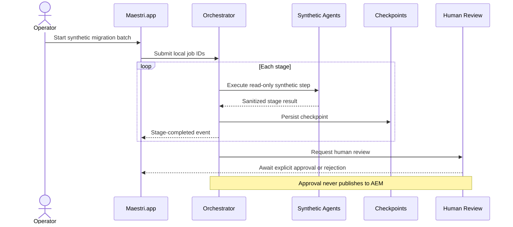
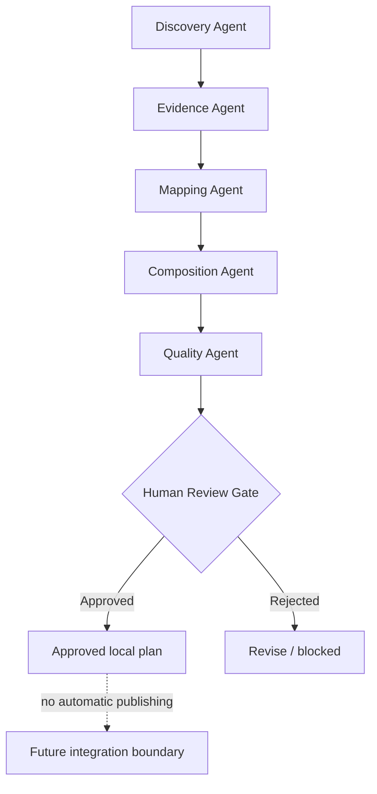

# Migration Maestro — Local architecture and UML

Migration Maestro is a **local-first migration orchestration workbench**. It is specialized for analyzing legacy pages, matching a sanitized AEM component catalog, preparing a Next.js/Universal Editor composition proposal, validating evidence, and handing the result to a human reviewer. GitHub and Azure DevOps adapters are intentionally out of scope.

## UML component diagram

## UML sequence diagram — page migration

## Agent dependency diagram

The `src/orchestration/agent-graph.ts` module now validates a local agent DAG with deterministic ordering, cycle detection, and a mandatory final human review gate. **It is a planning contract, not a live six-agent executor**: the currently running workbench still uses its existing three-stage synthetic evidence/composition/quality pipeline. The graph is the blueprint for incremental local agent execution and MCP routing.

## Planned local-first milestones

1. Bind graph nodes to local agent handlers and checkpointed task execution.
2. Add agent assignment, retries, bounded concurrency and cancellation.
3. Surface graph and agent state through supported Maestri.app capabilities.
4. Introduce local MCP transport and read-only metadata adapters with explicit allowlists.
5. Add opt-in model-provider agents with budget and data controls; keep approval and publishing separate.

No corporate source data, credentials, remote repository access, AEM writes or publication are required for the current development phase.
