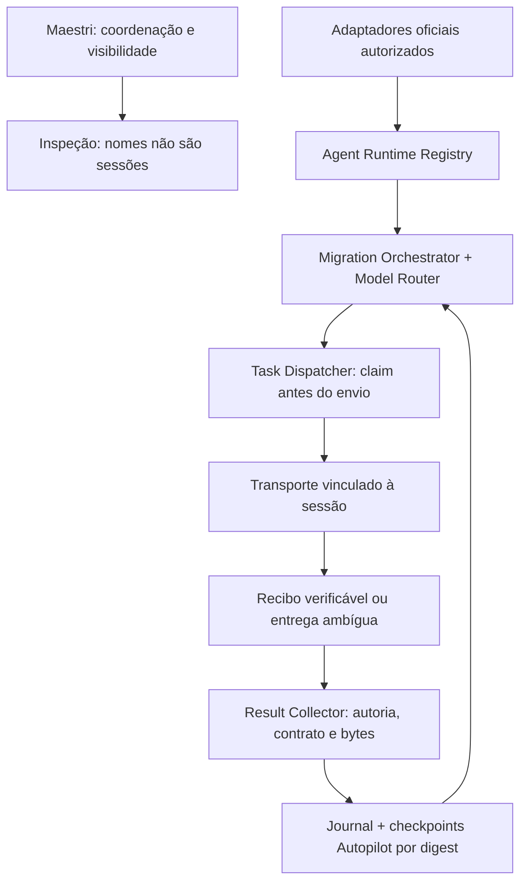

# Runtime comum do Migration Team

## Escopo entregue

Infraestrutura de orquestração independente do provedor: registro verificável,
Model Router, dispatcher, coletor, journal durável e entrada Autopilot. Um único
`RuntimeTask` estende `DispatchRequest`; os resultados reutilizam `StageResultV2`.
Os contratos suportam endereços Codex App Server, Claude Agent SDK e Maestri, sem
inventar terminalId para runtimes diretos.

**Os drivers live estão implementados, mas ainda dependem de configuração local e de
um verificador de capacidade confiável.** O CLI não usa o protótipo simulado como
fallback e não usa `maestri ask` como prova. Sem configuração, sessão gerenciada e
verificação de modelo/capacidade, as rotas continuam bloqueadas. Testes de protocolo
com eventos controlados exercitam os drivers sem afirmar que um provedor real foi
executado.

## Arquitetura e confiança



O coordenador determinístico executa a política do Migration Orchestrator. Exige
uma sessão verificável desse papel, capacidade `coordination` e perfil ADVANCED;
não manda um prompt adicional de coordenação nem cria uma sétima tarefa. O modelo
do coordenador é registrado na autorização, enquanto a seleção das etapas ocorre
localmente no Model Router existente.

| Etapa | Papel exigido | Capacidade | Perfil mínimo | Dependências |
| --- | --- | --- | --- | --- |
| ANALYZE | Analytics | analysis | ECONOMY | fonte validada |
| DISCOVER_COMPONENTS | UE-Pattern | mapping | BALANCED | ANALYZE |
| MAP_COMPONENTS | UE-Pattern | mapping | BALANCED | ANALYZE + DISCOVER_COMPONENTS |
| PLAN | Hermes | planning | ADVANCED | MAP_COMPONENTS |
| IMPLEMENT | Hermes | coding | ADVANCED | PLAN |
| VALIDATE | qualquer sessão comprovada | validation | BALANCED | IMPLEMENT |

Não há fallback de papel nas primeiras cinco etapas. VALIDATE não presume que
Analytics ou um nome `Validator` comprova validação. Não há downgrade de Hermes.
O grafo atual é sequencial porque seus insumos são dependentes; nenhuma etapa é
paralelizada. A descoberta dos transportes é paralela e somente leitura.

`AgentRuntimeTransport` define `discover`, `send`, `reconcile` e `collect`, com
AbortSignal e prazo de cinco segundos por chamada. O timeout de envio mantém o
resultado ambíguo, pois cancelar localmente não prova cancelamento no destino.
O adaptador deve retornar rapidamente um recibo de aceitação e coletar o resultado
posteriormente, sem tentar completar uma inferência inteira dentro desse prazo.

O registro verifica evidências assinadas Ed25519 por uma autoridade cuja chave
pública foi previamente aprovada pelo operador. Cada envelope vincula issuer,
challenge aleatório, tipo, validade de até 60 segundos e payload canônico. Sessões
incluem agente, provedor, modelo, perfil, capacidades, disponibilidade, workspace,
sessionId, connectionId e endereço. O adaptador só pode assinar depois de verificar
essas propriedades e o isolamento do escopo em um canal oficial confiável.

**Assinatura não cria prova upstream de inferência nem competência semântica.**
Ela demonstra a autoridade configurada. O operador precisa auditar a origem da
chave, o código verificador, a evidência de capacidade e a política de perfil.
Um adaptador que simplesmente assina declarações, rodapés ou nomes viola o contrato.
Não há importação de JSON de sessão como substituto de verificação contemporânea.
Reexecução de evidências antigas falha no challenge ou na validade. Checkpoints
já aceitos verificam assinatura e validade no instante de aceitação registrado,
sem reinterpretar o resultado como uma sessão disponível agora.

## Entrega, resultados e recuperação

A autorização fixa jobId, runId, fonte, sessões, coordenador, trustDigest, etapas,
aprovador, expiração e escopo `artifact-only-no-external-writes`. Esse documento
representa autorização do operador, não identidade do runtime. `run` verifica os
gates antes de criar claims e novamente antes do envio. Somente artefatos locais
são permitidos; IMPLEMENT não escreve em AEM nem faz publicação/deploy.

O claim exclusivo é persistido e sincronizado antes de chamar `send`. O recibo
assinado deve conter taskId, requestDigest, sessionDigest, receiptId e accepted.
ACK textual, exit code ou retorno de comando nunca marca entrega. Após falha,
repetir o mesmo comando chama apenas `reconcile` para o claim existente, sem enviar
novamente e sem trocar o provedor/sessão. Um resultado `null` mantém o bloqueio.
Mudança de sessão, escopo da autorização, fonte ou insumos exige revisão; não há rebind automático.

O coletor verifica assinatura/autoria relativa ao runtime aprovado, recibo, tarefa,
contrato v2, conjunto exato de artefatos, base64 canônico e SHA-256 dos bytes.
Os artefatos ficam dentro do checkpoint assinado, sem escrever caminhos escolhidos
pelo agente ou executar código retornado. Cada etapa exige `<STAGE>.output.json`:

```json
{
  "version": 1,
  "jobId": "id do job",
  "taskId": "id da tarefa",
  "stage": "ANALYZE",
  "inputs": {"source": "digest da fonte"},
  "inventory": ["observação sustentada pelos insumos"],
  "limitations": ["limitações da análise"]
}
```

As chaves obrigatórias por etapa são `inventory`, `components`, `mappings`, `steps`,
`files` e `checks`, respectivamente, como listas de strings não vazias. VALIDATE
exige também `passed: true`. `inputs` deve coincidir com os digests fornecidos;
artefatos dos predecessores e o HTML da fonte seguem no pedido. O envelope v2
inclui resumo, evidências e hashes. Esse contrato é estrutural; revisão de qualidade,
paridade visual e contratos específicos de AEM continuam etapas separadas. A captura
da fonte não conclui ANALYZE, e sucesso do pipeline termina em `awaiting-review`.

O runner reaproveita `runCheckpointed`, valida novamente cada resultado antes de
confiar no cache e reconstrói o checkpoint Autopilot após interrupção entre registros.
Claims/resultados são imutáveis; registros de reconciliação são separados. O lock
impede concorrência. Um registro exclusivo no diretório pai fixa o job ao primeiro
run e impede outra execução irmã de despachar novamente o mesmo job; mudar essa
vinculação exige reconciliação e revisão manual, nunca exclusão automática. Em encerramento abrupto, um lock órfão exige confirmar a parada
do processo e removê-lo manualmente; nunca remover claims para forçar reenvio.
Arquivos parciais/corrompidos falham fechados. Não se promete exactly-once remoto.

Histórico: `.local-maestro/public-migrations/<jobId>` é somente leitura.
Execuções: `.local-maestro/team-runs/<jobId>/<runId>`. O comando não reescreve o
manifesto, status, plano, evidências ou checkpoints históricos. A fonte concluída
é verificada por SHA-256; seu registro não vira checkpoint de análise.

## Interfaces oficiais e bloqueios atuais

Consultadas em 2026-11-19:

- [Codex App Server](https://learn.chatgpt.com/docs/app-server): o driver usa stdio,
  initialize/thread/start, thread/read, turn/start e eventos item/turn correlacionados.
  O executável local é observado pelo usuário; requests de ferramenta do servidor são
  negados. Sessões externas são só listadas. Thread iniciado localmente recebe sandbox
  read-only sem rede, mas a configuração atual **não comprova isolamento de MCP/plugin**;
  por isso o driver Codex deixa `scopeEnforced` falso e não se torna roteável sem uma
  qualificação confiável específica.
- [Claude Agent SDK](https://code.claude.com/docs/en/agent-sdk/overview): o driver usa
  `query()` com streaming, captura `system/init`, UUID da mensagem de entrada, eventos
  `assistant` e `result` com `user_message_uuid`, `session_id`, modelUsage e structured
  output. Mantém `tools: []`, `mcpServers: {}`, `plugins: []`, `dontAsk` e nega callbacks
  de ferramenta. Sessões externas listadas não são retomadas. A dependência oficial deve
  ser instalada no Mac; não estava disponível neste sandbox.
- [Maestri Wire](https://www.themaestri.app/en/docs/wire): coordenação e endereçamento
  de terminal. O adaptador local existente continua reportando
  `MAESTRI_SESSION_BOUND_DISPATCH_UNSUPPORTED`. Listagem não estabelece sessão
  autenticada do provedor, pré-condição de sessão no envio ou autoria do resultado.

Não foram usadas APIs privadas nem engenharia reversa. O socket local é criado pelo
próprio serviço do Migration Maestro, com caminho em diretório privado e permissão
0600; ele não descobre ou acessa sockets de provedores/Maestri. Falhas de DNS na
instalação do pacote Claude e `EPERM` ao abrir listener local neste sandbox são
limitações deste ambiente, não motivo para mudar permissões ou contorná-lo. Execute
instalação e teste de listener no terminal original do Mac.

O output schema comum usa `result` v2 e `artifacts: [{file, content}]`. O modelo
retorna texto UTF-8 dos artefatos; o transporte converte os bytes e calcula SHA-256
localmente antes de montar `StageResultV2`. O validador cruza `jobId`, `taskId`,
`stage`, `requestDigest`, sessionId, recibo provider e hash real dos bytes. Uma
resposta textual sem event/result correlacionado nunca é aceita.

## Disponibilidade e primeira execução autorizada

```sh
nvm use 22.23.2
npm run maestro:team -- inspect --job 6c23a49df3f6b1798231
```

Exit 0: todas as rotas têm sessões verificáveis; exit 2: suporte/sessão ausente;
exit 1: erro de configuração/fonte. A inspeção não faz dispatch nem escreve jobs.
Este comando é também o smoke test live sem tarefas. No sandbox observado: zero
sessões verificadas, Maestri indisponível; as rotas bloqueiam sem configuração,
capacidade/modelo comprovados e qualificação de isolamento. `maestro:runtime init`
cria a configuração inicial e, após configurar provedores, chave e arquivo adapter local; `serve` mantém os processos vivos e
`prepare --authorize-session-creation` cria sessão nova, sem enviar task de migração.

### Configuração oficial no Mac

Em uma pasta de configuração privada fora do repositório, instale a biblioteca oficial
do Claude em um prefixo local (o comando acessa o registry npm e não foi possível
executá-lo neste sandbox):

```sh
mkdir -p "$HOME/.migration-maestro"
npm install --prefix "$HOME/.migration-maestro/claude-sdk" --save-exact @anthropic-ai/claude-agent-sdk
```

No macOS, faça o bootstrap antes de editar a configuração:

```sh
nvm use 22.23.2
npm run maestro:runtime -- init --config "$HOME/.migration-maestro/runtime.json"
```

O comando cria os diretórios ausentes e um JSON válido com `providers: []`, sem
sessões, modelos, verificadores ou autorizações. A saída `configuration-required`
indica que o operador precisa preencher os provedores. `serve` e `prepare`
bloqueiam com `NATIVE_CONFIG_INCOMPLETE` nessa fase. Arquivo ausente resulta em
`NATIVE_CONFIG_MISSING`, com orientação para executar init.

Edite `$HOME/.migration-maestro/runtime.json` usando caminhos absolutos. `codex` deve
ser o resultado de `command -v codex`; `sdkRoot` pode ser o prefixo absoluto da instalação,
por exemplo `/Users/SEU_USUARIO/.migration-maestro/claude-sdk`. O loader resolve
`@anthropic-ai/claude-agent-sdk` em `node_modules` a partir desse diretório.
JSON não expande `~` nem `$HOME`; substitua pelo caminho absoluto.
Escolha os modelos exatos que o operador autorizou. A configuração não certifica
perfil nem competência: forneça também um verifier JS revisado, com SHA-256, que
retorne uma qualificação apenas após evidência real, ligada a `sessionId` e
`connectionId`. Sem verifier, o registry observa a sessão mas mantém todas as tarefas
bloqueadas.

```json
{
  "version": 1,
  "stateDirectory": "/Users/SEU_USUARIO/.migration-maestro/runtime",
  "socketPath": "/Users/SEU_USUARIO/.migration-maestro/runtime/runtime.sock",
  "workspaceId": "migration-team-local",
  "providers": [
    {"id":"codex","provider":"codex","executable":"/CAMINHO/ABSOLUTO/codex","roles":[
      {"agentId":"Migration Orchestrator","modelId":"MODELO_CODEX_ADVANCED"},
      {"agentId":"Analytics","modelId":"MODELO_CODEX_ECONOMY"},
      {"agentId":"UE-Pattern","modelId":"MODELO_CODEX_BALANCED"},
      {"agentId":"Hermes","modelId":"MODELO_CODEX_ADVANCED"},
      {"agentId":"Validator","modelId":"MODELO_CODEX_BALANCED"}],
      "verifier":{"module":"/CAMINHO/ABSOLUTO/codex-capability-verifier.mjs","sha256":"SHA256_DO_VERIFIER"}},
    {"id":"claude","provider":"claude-code","sdkRoot":"/Users/SEU_USUARIO/.migration-maestro/claude-sdk","roles":[
      {"agentId":"Migration Orchestrator","modelId":"MODELO_CLAUDE_ADVANCED"},
      {"agentId":"Analytics","modelId":"MODELO_CLAUDE_ECONOMY"},
      {"agentId":"UE-Pattern","modelId":"MODELO_CLAUDE_BALANCED"},
      {"agentId":"Hermes","modelId":"MODELO_CLAUDE_ADVANCED"},
      {"agentId":"Validator","modelId":"MODELO_CLAUDE_BALANCED"}],
      "verifier":{"module":"/CAMINHO/ABSOLUTO/claude-capability-verifier.mjs","sha256":"SHA256_DO_VERIFIER"}}
  ]
}
```

Substitua os placeholders por caminhos, IDs e modelos que existam. Cada verifier é
código confiável do operador: não pode mapear nomes/configuração para capacidade; deve
provar identidade, modelo efetivo, perfil, disponibilidade, capabilities e isolamento.
O esquema exige resultados diferentes para cada papel. A interface do provider não
atesta semântica por si só; enquanto essa prova não existir, o teste correto é rota
bloqueada.

```sh
npm run maestro:runtime -- init --config "$HOME/.migration-maestro/runtime.json"
npm run maestro:runtime -- serve --config "$HOME/.migration-maestro/runtime.json"
```

O segundo `init`, após preencher os provedores, cria a chave e os adaptadores sem
iniciar os drivers. Repetir `init` preserva os bytes da configuração, chave e
adaptadores. Configuração inválida é preservada e produz erro. Alterações posteriores
de configuração ou implementação que invalidem os adaptadores produzem
`NATIVE_INSTALLATION_CHANGED_REVIEW_REQUIRED`; não há substituição automática.
Para uma instalação distinta revisada, escolha explicitamente novos
`stateDirectory` e `socketPath`, preservando a instalação anterior.

Em outro terminal, após revisar explicitamente a criação de uma sessão nova por papel:

```sh
npm run maestro:runtime -- prepare --config "$HOME/.migration-maestro/runtime.json" --transport codex --agent Analytics --authorize-session-creation
npm run maestro:runtime -- prepare --config "$HOME/.migration-maestro/runtime.json" --transport codex --agent UE-Pattern --authorize-session-creation
npm run maestro:runtime -- prepare --config "$HOME/.migration-maestro/runtime.json" --transport codex --agent Hermes --authorize-session-creation
npm run maestro:runtime -- prepare --config "$HOME/.migration-maestro/runtime.json" --transport claude --agent Validator --authorize-session-creation
npm run maestro:team -- inspect --job 6c23a49df3f6b1798231 --adapter-config "$HOME/.migration-maestro/runtime/team-adapters.json"
```

O smoke test apenas lista metadados/sessões gerenciadas e capabilities qualificadas.
Não executa turn/start ou query com mensagem de usuário. Se o isolamento Codex/MCP não
puder ser provado, continue usando Claude para esses papéis ou deixe a rota bloqueada.

Para instalar outro transporte autorizado, forneça configuração local revisada:

```json
{
  "version": 1,
  "adapters": [{
    "id": "runtime-aprovado",
    "module": "/caminho/absoluto/adapter-bundle.mjs",
    "sha256": "SHA-256 dos bytes do bundle revisado",
    "publicKey": "-----BEGIN PUBLIC KEY-----\n...\n-----END PUBLIC KEY-----\n"
  }]
}
```

O bundle exporta `createTransport(): AgentRuntimeTransport`, modo `live`. É código
confiável instalado pelo operador, não um arquivo produzido por agentes. A carga
executa os bytes exatos aprovados (data URL); empacote dependências relativas em um
bundle e audite também dependências externas absolutas. A chave privada pertence
ao verificador confiável, nunca ao agente. O loader não cria sandbox para código
instalado: o adaptador deve comprovar isolamento e negar escrita externa no runtime.
Inspeção só chama `discover`; nenhuma inferência ou ferramenta de agente é permitida
por esse método. `reconcile` é somente leitura e nunca deve retomar/enviar prompts.

Depois de instalar e verificar o adaptador:

```sh
npm run maestro:team -- inspect --job 6c23a49df3f6b1798231 --run-id first-authorized-run --adapter-config .local-maestro/team-adapters.json
```

Revise o `authorizationTemplate` da saída, selecione as etapas, preencha `approvedBy`
e `expiresAt` em ISO UTC e salve como `.local-maestro/team-authorization.json`. Não complete
os digests ausentes manualmente para contornar bloqueios. Sessões e conexão precisam
continuar iguais; timestamps frescos não mudam os digests de identidade.

Primeira execução real, **somente quando todos os gates estiverem satisfeitos**:

```sh
npm run maestro:team -- run --job 6c23a49df3f6b1798231 --run-id first-authorized-run --adapter-config .local-maestro/team-adapters.json --authorization .local-maestro/team-authorization.json --pause-after ANALYZE
```

O comando foi preparado, não executado. Ele pausa após ANALYZE. Para avançar até
VALIDATE sob a mesma autorização válida e mesmos insumos, use `--pause-after VALIDATE`.
Repita o mesmo runId para reconciliar interrupções. Não altere o escopo da autorização de um
run já iniciado nem crie outro run para reenviar um claim ambíguo. O operador pode
renovar explicitamente `expiresAt` e `approvedBy` mantendo o mesmo escopo e sessões;
cada aprovação fica registrada separadamente. O digest da tarefa vincula o escopo
da autorização, e o histórico registra o digest integral de cada aprovação.

## Validação da entrega

- `npm run check`: aprovado com Node 22.23.2.
- `npm test`: 555 testes, 553 aprovados, 2 ignorados, nenhuma falha.
- 22 testes novos de integração, com fluxo completo para Codex e Claude, assinatura,
  sessão, perfil, autorização, recibos, artefatos, interrupção, renovação de aprovação,
  reconciliação, bloqueio de runs duplicados e preservação de histórico.
- `git diff --check` e verificação de whitespace dos arquivos novos: aprovados.
- SHA-256 de 10.495 arquivos históricos preexistentes: nenhum alterado.
- `maestro:team inspect` executado em modo leitura; `run` não executado.

## Inspeção local de Analytics — 2026-11-20

O binário `/Users/macos/.nvm/versions/node/v22.23.2/bin/codex` confirmou
`codex-cli 0.170.0`. Seus tipos oficiais, gerados com
`app-server generate-ts`, incluem os métodos/campos usados pelo driver:
`thread/list` com `useStateDbOnly`, `thread/start` com política/sandbox,
`turn/start` com `clientUserMessageId` e sandbox `readOnly` com
`networkAccess`. Isso confirma correspondência estrutural; não comprova execução,
isolamento ou capacidades. O handshake de inspeção foi impedido por
`Operation not permitted (os error 1)` antes da resposta a `initialize`.
Não foram criadas sessões nem enviados prompts.

O bootstrap encontrou a configuração existente com `providers: []` e a preservou.
O modelo de Analytics ainda exige escolha explícita: `gpt-6.1-sol` está declarado
em uma configuração de escopo `isolated-synthetic`; `gpt-6-luna` consta apenas
de um plano não aplicado. Nenhum desses registros aprova automaticamente o runtime
nativo. O executável a configurar é
`/Users/macos/.nvm/versions/node/v22.23.2/bin/codex`.

Após configurar o modelo autorizado e inicializar os adaptadores, no terminal do
Mac, a partir da raiz deste repositório:

```sh
export PATH="/Users/macos/.nvm/versions/node/v22.23.2/bin:$PATH"
node --version
npm run maestro:runtime -- init --config "$HOME/.migration-maestro/runtime.json"
npm run maestro:runtime -- serve --config "$HOME/.migration-maestro/runtime.json"
```

O serviço deve imprimir `NATIVE_SERVICE_READY`. Em outro terminal, o comando
abaixo lê o endpoint instalado e verifica a assinatura da observação. Não chama
`prepare` nem envia prompts; a observação pode iniciar o processo App Server e
listar metadados de sessões externas, sem assumir controle delas:

```sh
export PATH="/Users/macos/.nvm/versions/node/v22.23.2/bin:$PATH"
node --import tsx --input-type=module <<'JS'
import { readFile } from 'node:fs/promises';
import { homedir } from 'node:os';
import { join } from 'node:path';
import { loadNativeConfig } from './src/agent-runtime/native/config.ts';
import { nativeTransportClient } from './src/agent-runtime/native/client.ts';
const config = await loadNativeConfig(join(homedir(), '.migration-maestro/runtime.json'));
const installed = JSON.parse(await readFile(join(config.stateDirectory, 'team-adapters.json'), 'utf8'));
const endpoint = installed.adapters.find(a => a.id === 'codex');
if (!endpoint) throw Error('CODEX_ADAPTER_NOT_CONFIGURED');
const client = nativeTransportClient(endpoint);
try {
  const observations = await client.observations(AbortSignal.timeout(20000));
  console.log(JSON.stringify({
    ipc: 'responded-and-signature-verified',
    managed: observations.filter(o => o.ownership === 'managed'),
    externalCount: observations.filter(o => o.ownership === 'external').length
  }, null, 2));
} finally {
  client.close();
}
JS
```

Sem criação explícita de sessão, não se espera um Analytics gerenciado disponível.
Uma resposta IPC assinada não constitui prova de capacidade semântica ou isolamento.
Se `init` informar `NATIVE_INSTALLATION_CHANGED_REVIEW_REQUIRED`, preserve chaves
e estado e revise a divergência; não exclua arquivos para prosseguir.

## Analytics aprovado: aplicação local pendente

O operador aprovou `gpt-6-luna` para Analytics no provedor `codex-local`, com
executável `/Users/macos/.nvm/versions/node/v22.23.2/bin/codex`.
A inspeção encontrou `providers: []`, sem diretório de estado, chave ou
`team-adapters.json`; não há digest instalado para reconciliar.
A configuração proposta passou em `validateNativeConfig`, mas o sandbox negou
a criação do backup com `EPERM`. O arquivo original permaneceu intacto.

No terminal do Mac, na raiz do repositório, aplique a decisão já aprovada:

```sh
export PATH="/Users/macos/.nvm/versions/node/v22.23.2/bin:$PATH"
node --import tsx scripts/configure-native-analytics.mjs
npm run maestro:runtime -- init --config "$HOME/.migration-maestro/runtime.json"
npm run maestro:runtime -- serve --config "$HOME/.migration-maestro/runtime.json"
```

O script cria um backup exclusivo com permissão 0600 antes de alterar o JSON,
preserva os demais campos e bloqueia conflitos de provedor/modelo, instalação
parcial ou divergência dos adaptadores. Não inicializa sessões nem provedores.
Se houver conflito, preserve configuração, backup, chave e adaptadores; compare o
digest instalado com o atual e o proposto. Uma instalação separada exige revisão
explícita de novos caminhos de estado/socket, sem remover a identidade anterior.

Em outro terminal, teste a conectividade e a assinatura da observação:

```sh
export PATH="/Users/macos/.nvm/versions/node/v22.23.2/bin:$PATH"
node --import tsx --input-type=module <<'JS'
import { readFile } from 'node:fs/promises';
import { homedir } from 'node:os';
import { join } from 'node:path';
import { loadNativeConfig } from './src/agent-runtime/native/config.ts';
import { nativeTransportClient } from './src/agent-runtime/native/client.ts';
const config = await loadNativeConfig(join(homedir(), '.migration-maestro/runtime.json'));
const installed = JSON.parse(await readFile(join(config.stateDirectory, 'team-adapters.json'), 'utf8'));
const endpoint = installed.adapters.find(a => a.id === 'codex-local');
if (!endpoint) throw Error('CODEX_LOCAL_ADAPTER_NOT_CONFIGURED');
const client = nativeTransportClient(endpoint);
try {
  const observations = await client.observations(AbortSignal.timeout(20000));
  console.log(JSON.stringify({
    ipc: 'responded-and-signature-verified',
    managedCount: observations.filter(o => o.ownership === 'managed').length,
    externalCount: observations.filter(o => o.ownership === 'external').length
  }, null, 2));
} finally { client.close(); }
JS
```

Esse teste inicia o processo do provedor sob demanda e consulta metadados, sem
criar sessões ou enviar prompts. Nenhuma sessão gerenciada é esperada nesta etapa.
A aprovação do modelo não comprova acesso da conta, capacidade semântica ou
isolamento; o bloqueio anterior de inicialização App Server por `Operation not
permitted` ainda precisa ser reavaliado no terminal do Mac.

## Observação da sessão Analytics e proposta do segundo provedor

Estado inspecionado nesta rodada (2026-11-20):
- Configuração ativa: somente `codex-local`, Analytics, `gpt-6-luna`.
- Digest calculado e instalado coincidem:
  `bae5af30e55b3dabf83e50a62de8f20b7312edd5f5fcdbb302534b52e23b6f04`.
- Socket, `service.lock`, chave Ed25519 e diretório `codex-local` existem.
  A presença do lock/socket não comprova que o processo esteja saudável.
- A observação IPC retornou `NATIVE_SERVICE_UNAVAILABLE`; um probe de conexão
  sem payload identificou `connect EPERM /Users/macos/.migration-maestro/runtime/runtime.sock`.
  Não foi possível reconfirmar a disponibilidade informada no prepare pelo operador.
- SDK instalado: `@anthropic-ai/claude-agent-sdk@0.3.329`, Claude Code associado
  `2.1.329`. Importação pelo loader existente confirmou funções `query` e
  `listSessions`, sem chamá-las. `claude auth status` retornou código 1,
  `loggedIn: false`, `authMethod: none`, `apiProvider: firstParty` neste ambiente.
  Isso não comprova o estado de outras contas ou ambientes do operador.

### Observação sem nova sessão

Mantenha o serviço atual vivo. Não execute init, prepare nem reinicie o serviço
para fazer esta observação. Na raiz do checkout, em outro terminal:

```sh
export PATH="/Users/macos/.nvm/versions/node/v22.23.2/bin:$PATH"
node --import tsx scripts/observe-native-analytics.mjs
```

O script compara configuração/código com o digest instalado, usa o cliente
existente para verificar assinatura Ed25519, challenge aleatório e validade temporal
da resposta `observe`, e exige:
`codex-local`, `Analytics`, `gpt-6-luna` e sessão
`01a1f928-e639-7811-a40d-01817d1ac362`.
Código 0 confirma `managed`, conexão identificada e `available: true` naquele
instante; código 2 indica sessão encontrada mas indisponível/desanexada; código 1
indica erro, divergência, identidade/modelo incorretos ou sessão ausente/duplicada.
A saída inclui data de observação, connectionId, scopeEnforced e diagnósticos.
Não produz qualificação nem autorização. O servidor consulta `thread/read` e
lista metadados; não chama `thread/start`, `thread/resume` ou `turn/start`.
Observação pode inicializar diretórios de journal caso ausentes; não é uma
garantia de filesystem absolutamente imutável do lado do servidor.

Os novos arquivos de observação ficam fora de `src/agent-runtime/native`, evitando
alterar o digest da implementação nativa instalada nesta rodada.

### Evidência necessária para os três diagnósticos

| Diagnóstico | Evidência proposta | O que não basta |
| --- | --- | --- |
| SEMANTIC_CAPABILITY_EVIDENCE_REQUIRED | Relatório de avaliação revisado com critérios de analysis: extração/inventário, rastreabilidade às fontes, limitações, rejeição de instruções injetadas e conformidade ao schema. Registrar corpus, versão, hashes, resultados e julgamento independente. Prova de identidade/modelo da sessão atual deve ligar o relatório à sessionId e connectionId com prazo de validade. Avaliações com prompts só em futura etapa explicitamente autorizada. | Nome Analytics, catálogo, capability declarada ou sucesso de prepare. |
| PROFILE_POLICY_EVIDENCE_REQUIRED | Política versionada e aprovada de classificação ECONOMY/BALANCED/ADVANCED, baseada em critérios documentados, evidência de modelo efetivo, escopo/risco e avaliação. Assinar/hashar política e decisão específica, vinculadas à identidade observada e expiração. | Sufixo luna, preço estimado ou regra sintética do router. |
| CODEX_EXTERNAL_TOOL_ISOLATION_EVIDENCE_REQUIRED | Atestação verificável de restrições efetivas de ferramentas, MCP/plugins, filesystem e rede, com identidade/hash do executável e configuração efetiva. Em ambiente isolado autorizado, testar negações de escrita externa, chamadas MCP/plugins e egress, registrando resultados e enforcement independente do texto do modelo. | Sandbox solicitado read-only, approvalPolicy never, negar callbacks ou ausência de ferramentas em uma resposta. |

O driver hoje fixa `scopeEnforced: false` porque não comprova isolamento de
ferramentas externas. O verifier pode atestar escopo somente com evidência real.
Seu módulo revisado deve ter SHA-256 aprovado e retornar `NativeQualification`
vinculada à sessão/conexão/modelo, evidenceDigest e expiresAt, sem converter nomes
ou configuração em prova. `discover` permanece sem rotas qualificadas até os gates
serem satisfeitos. Esta rodada não executou as avaliações propostas.

### Modelo candidato para Validator

A [lista oficial da Anthropic](https://platform.claude.com/docs/en/models/overview)
documenta `claude-sonnet-5-5` como ID real, com combinação de velocidade e
inteligência. É o candidato proposto para validação/revisão de artefatos, sujeito a
avaliação e aprovação do operador; não há confirmação de acesso nesta conta.

No SDK instalado, `ModelInfo.value` é o identificador, `displayName` é apresentação
e `resolvedModel` informa o ID canônico quando há alias. `supportedModels()`
pertence ao objeto Query; não foi chamado porque não abrimos uma Query/sessão.
Não tratar o exemplo `claude-sonnet-5` do arquivo de tipos como catálogo atual.

Próximo passo sem inferência: verificar autenticação no ambiente do serviço e
consultar catálogo autenticado pelo mecanismo oficial desse mesmo backend.
Para autenticação por API, [GET /v1/models](https://platform.claude.com/docs/en/api/models/list)
pode confirmar disponibilidade de catálogo, sem Messages API. Não reutilizar
tokens OAuth privados como API key. Um catálogo de API não atesta acesso de uma
assinatura Claude Code diferente. Sem um mecanismo compatível que não abra Query,
a confirmação SDK fica pendente de autorização específica futura.
Depois, modelo efetivo, correlação de resultados e qualificação continuam gates
separados; existência no catálogo não prova qualidade para Validator.

Proposta de entrada (NÃO aplicada, nem aprovada como modelo):
```json
{
  "id": "claude-local",
  "provider": "claude-code",
  "sdkRoot": "/Users/macos/.migration-maestro/claude-sdk",
  "roles": [{"agentId": "Validator", "modelId": "claude-sonnet-5-5"}]
}
```

### Proposta transacional — ainda não implementada nem aplicada

O init atual é criador/idempotente, não atualizador. Acrescentar Claude altera o
digest global (incluindo o adaptador Codex) e deve continuar causando
`NATIVE_INSTALLATION_CHANGED_REVIEW_REQUIRED`. Não editar team-adapters.json,
remover locks, excluir chaves ou reaproveitar init como migração.

A implementação futura deve ser uma operação administrativa dedicada:

1. **Planejar somente leitura:** fixar hashes dos bytes de config/adapters, digest
   de implementação, fingerprint da chave pública, inventário de hashes dos
   journals e estado da sessão. Verificar vínculo entre chave e adaptadores.
   Produzir diff que apenas acrescente claude-local e um manifesto de transação,
   com hash esperado da base e hash proposto. Sem copiar chave privada para o repo.
2. **Aprovar a proposta exata:** vincular identidade do aprovador, prazo, modelo,
   backend, plano de indisponibilidade e hashes. Rejeitar qualquer alteração da
   base após aprovação. Verificar ausência de tarefas pendentes/claims ambíguos.
3. **Resolver a continuidade antes de aplicar:** o serviço atual não recarrega
   provedores e o driver mantém ownership em memória. Parar/reiniciar preserva
   journals, mas transforma a sessão registrada em managed-detached e perde a
   disponibilidade gerenciada. Preservar chave/arquivos não preserva a conexão.
   Se continuidade da sessão viva for requisito, BLOQUEAR a atualização até haver
   suporte revisado a reconfiguração em processo/recuperação oficial, testado
   separadamente. Não retomar nem recriar sessão silenciosamente.
4. **Preparar uma geração imutável:** sob exclusão administrativa e estado
   quiescente comprovados, criar diretório privado de transação, backups 0600 e
   nova geração de config/adapters; manter chave Ed25519 e journals nos caminhos
   originais. Gerar adaptadores pelo código confiável, nunca por edição manual.
   Assinar manifesto de transição com a mesma chave, incluindo hashes antigo/novo,
   fingerprint e aprovação; fsync dos arquivos e diretórios.
5. **Commit único:** o runtime futuro deve ler config/adapters da mesma geração
   por um único ponteiro ativo, substituído por rename atômico no mesmo filesystem.
   Dois renames independentes de runtime.json e team-adapters.json NÃO são uma
   transação. A migração inicial para gerações exige um comando dedicado, backups,
   verificação de base e suporte do loader; não existe hoje. Leitores rejeitam
   geração parcial e transação pendente, sem fallback permissivo.
6. **Verificar e registrar:** confirmar assinatura de transição, mesma chave
   pública, hashes dos journals preservados e providers/roles Codex inalterados.
   O digest global do adaptador Codex necessariamente muda. Registrar checksums e
   estado final em journal administrativo append-only, sem modificar jobs antigos.
7. **Recuperar/rollback:** antes do commit, abandonar a geração candidata mantendo
   a ativa. Depois do commit, rollback autorizado apenas se nenhum novo trabalho
   ocorreu; registrar evento e trocar o ponteiro de volta sem apagar gerações,
   chave ou journals. Crash após commit deve ser detectado pelo ponteiro/manifesta;
   repetir a operação com o mesmo transactionId não gera nova chave nem sessões.
   Claims ambíguos exigem reconciliação, não rollback automático.

Nota de confiança: team-adapters.json atual contém âncoras (chave pública e digest),
mas não tem assinatura própria. As respostas IPC são assinadas. A proposta adiciona
um manifesto de transição assinado; não afirma que o JSON existente já o seja.

Testes exigidos antes de implementar/aprovar aplicação: falha injetada em cada
passo de persistência, concorrência/CAS, reinício após commit, replay da aprovação,
alteração de chave/base, journals invariantes, rollback sem novas tarefas e
preservação ou bloqueio explícito de sessões vivas. Nenhum comando de aplicação é
fornecido como existente: o CLI atual só suporta init/serve/prepare.

Comandos de revisão executáveis agora, sem atualizar instalação:
```sh
export PATH="/Users/macos/.nvm/versions/node/v22.23.2/bin:$PATH"
node --import tsx scripts/observe-native-analytics.mjs
claude auth status
npm run check
node --import tsx --test tests/native-observation.test.ts tests/native-runtime.test.ts tests/native-runtime-bootstrap.test.ts
git diff --check
```

A aprovação futura precisa cobrir o modelo Claude após comprovar acesso e a
estratégia de continuidade da sessão Codex, além do manifesto concreto gerado
pela implementação transacional. Não há autorização implícita para parar o
serviço, alterar a instalação ou criar sessão Validator nesta proposta.

## Runtime Generation Manager — implementação segura inicial

Implementado em `src/agent-runtime/generations/{manager,inspection,storage}.ts`,
fora da pasta `native`. A escolha evita alterar o hash dos arquivos nativos que
o serviço em execução usa. O comando administrativo é
`src/cli-runtime-generations.ts`; nenhum comando desse gerenciador foi executado
contra a instalação real nesta etapa. Testes usam instalações temporárias.

A sessão Analytics confirmada pelo operador continua sendo a sessão a preservar.
A inspeção somente leitura confirmou novamente o digest
`bae5af30e55b3dabf83e50a62de8f20b7312edd5f5fcdbb302534b52e23b6f04`.
A inspeção dos drivers locais confirmou Codex 0.170.0 e SDK Claude 0.3.329
(Claude Code 2.1.329 no manifesto), sem iniciar App Server ou Query.
Foram hashados o executável resolvido Codex e os 30 arquivos do pacote SDK.
Isso não autentica upstream nem fecha todas as dependências transitivas:
binários opcionais externos ao pacote SDK e dependências de launchers ainda
precisam entrar na revisão do loader futuro. Nenhuma disponibilidade de modelo
foi deduzida desses hashes.

### Limite funcional explícito

Esta entrega implementa o controle offline de gerações, não troca a instalação
que está servindo sessões. O runtime atual não tem barreira de admissão,
drenagem atestada nem loader de gerações. Por isso `activate` falha fechado com
`GENERATION_ACTIVATION_BLOCKED_FENCED_LOADER_NOT_IMPLEMENTED`, mesmo após um
relatório de drenagem válido. Não existe flag para desativar esse bloqueio.

Uma resposta assinada sobre um instante não impede que novas tarefas entrem
depois. A integração futura deve manter exclusão/fencing durante validação e
commit e fazer todos os leitores consumirem um único ponteiro de geração.
Também precisa de autorização específica para ativar, verificação de acesso
Claude e uma decisão aprovada sobre a continuidade do Analytics. A aprovação
DRAIN implementada aqui NÃO autoriza ativação, encerramento de sessão ou execução.

### Estados e comandos

| Estado de origem | Próximo estado | Condição/efeito implementado |
| --- | --- | --- |
| Inicialização | ACTIVE | Snapshot verificado da instalação; nenhuma escrita nela. |
| ACTIVE | UPDATE_PREPARED | Configuração aditiva válida, drivers em versões revisadas e geração isolada íntegra. |
| UPDATE_PREPARED | DRAINING | Aprovação Ed25519 de operador, vinculada ao candidato, revisão e expiração; registra intenção, não envia sinais ao runtime. |
| DRAINING | READY_TO_ACTIVATE | Relatório assinado pela identidade do runtime, recente e vinculado à revisão; sem trabalho pendente e sem sessões vivas. |
| READY_TO_ACTIVATE | ACTIVATED | Transição reservada no modelo, bloqueada na API/CLI até existir loader com fencing. |
| UPDATE_PREPARED, DRAINING, READY_TO_ACTIVATE, ACTIVATED | ROLLBACK_REQUIRED | Pedido de revisão ou recuperação de coordenação interrompida/integridade divergente. |
| ROLLBACK_REQUIRED | ACTIVE | Cancelamento offline autorizado, base íntegra e sem ativação anterior; conserva todos os candidatos e eventos. |

Não existem transições implícitas. Cada operação mutável recebe `--sequence N`.
Eventos numerados têm hashes encadeados e publicação exclusiva: duas operações
concorrentes não podem confirmar a mesma revisão. Um concorrente rejeitado pode
deixar um candidato órfão íntegro; ele é preservado, não ativado.

`ACTIVATED` está definido e sua matriz é testada, mas não é alcançável pela API
entregue. Rollback de uma instalação realmente ativada também está bloqueado.
O rollback implementado cancela preparação offline; não restaura processos,
arquivos históricos, chaves ou sessões.

### Layout e integridade

A raiz administrativa deve ser privada (0700), usar caminho canônico sem symlinks
e ficar separada tanto do diretório da configuração quanto do estado do runtime:

```text
ROOT/
  base.json
  events/00000000.json ...
  candidates/<uuid>/manifest.json
```

Cada arquivo publicado usa 0600. O manifesto contém configuração candidata,
adaptadores candidatos (com a mesma chave pública), digest da implementação,
hashes/versões locais e `access: unverified`. Não há escrita de
`team-adapters.json` instalado. A chave privada é lida somente para verificar seu
vínculo Ed25519 com a âncora pública; não é exportada, copiada ou usada para assinar
candidatos. Snapshot guarda seu hash, não seus bytes.

O inventário inclui todos os arquivos regulares do estado, inclusive journals e
checkpoints existentes ali. Socket e service.lock são excluídos do inventário:
eles não são prova de drenagem e jamais são removidos. Arquivos históricos fora
do estado não são abertos para escrita. Qualquer alteração ou novo arquivo no
inventário invalida a base; não há atualização silenciosa do snapshot. Isso pode
bloquear uma preparação enquanto o runtime trabalha, deliberadamente.

Configuração candidata deve preservar campos e provedores existentes integralmente.
O escopo inicial suporta `codex-local`/Analytics/`gpt-6-luna` e a adição
`claude-local`/Validator/`claude-sonnet-5-5`. O último continua sendo candidato,
sem autenticação/acesso comprovados. Nenhum verifier é fabricado.
Versões revisadas inicialmente: Codex 0.170.0 e SDK 0.3.329; versões diferentes
exigem revisão de compatibilidade, não ajuste automático da lista.

Publicação escreve um arquivo temporário, fsync, hard link exclusivo para o nome
final e fsync do diretório. Leitores só consideram registros completos publicados;
arquivos `.pending-*` de interrupções ficam ignorados e preservados. Gaps, JSON
corrompido e hashes divergentes falham fechados. Essa operação exige filesystem
local com suporte a hard links e fsync; não há promessa para storage remoto.
A cadeia de hashes detecta corrupção; não é um log imune a reescrita por quem
controla integralmente o filesystem. Aprovações e relatórios têm assinaturas
verificadas contra chaves previamente fixadas.

### Aprovação e relatório de drenagem

O inicializador recebe a chave pública Ed25519 do aprovador por arquivo,
selecionada e revisada pelo operador. Não usa uma chave gerada automaticamente.
A aprovação tem formato `{payload, signature}`, assinatura base64 de
`canonical(payload)` (função do projeto). O payload exige:
`version: 1`, `action: DRAIN | ROLLBACK`, `generation`, `manifestDigest`,
`sequence`, `approvedBy` e `expiresAt`. A assinatura deve ser produzida no
processo de aprovação confiável, sem disponibilizar chave privada ao agente.

O relatório usa o mesmo envelope, assinado pelo runtime confiável, com:
`version`, `generation`, `manifestDigest`, `sequence`, `observedAt`,
`expiresAt`, `evidenceDigest`, `admissionClosed`, `runtimeStopped`,
`inFlight`, `pendingClaims`, `ambiguousDeliveries` e `sessions`.
Os três contadores precisam ser zero; admissão fechada e runtime parado precisam
ser verdadeiros; validade/observação são limitadas a 60 segundos.
Cada sessão inclui sessionId, ownership, available e safeToClose.
Sessão managed, disponível ou insegura bloqueia READY_TO_ACTIVATE.
Sessões gerenciadas desconectadas são explicitamente `managed-detached`,
indisponíveis, com `replacementAuthorizationRequired: true`.

O runtime atual NÃO emite esse relatório. Não invente contadores, não considere
uma pasta vazia prova de ausência de claims e não assine relatórios manualmente
com a chave instalada para contornar essa lacuna. Os testes usam signatários e
relatórios de fixtures; não são atestação do runtime real.

### Comandos disponíveis para uma etapa futura aprovada

Não executar contra a instalação atual sem revisar a raiz, a chave do aprovador
e o candidato. `/CAMINHO/...` abaixo são arquivos a preparar/revisar, não arquivos
que esta entrega afirma ter criado:

```sh
export PATH="/Users/macos/.nvm/versions/node/v22.23.2/bin:$PATH"
node --import tsx src/cli-runtime-generations.ts --help

node --import tsx src/cli-runtime-generations.ts initialize \
  --root "$HOME/.migration-maestro-generations" \
  --config "$HOME/.migration-maestro/runtime.json" \
  --approver-key /CAMINHO/aprovador-publico.pem

node --import tsx src/cli-runtime-generations.ts prepare \
  --root "$HOME/.migration-maestro-generations" \
  --candidate /CAMINHO/runtime-candidato.json --sequence 0

node --import tsx src/cli-runtime-generations.ts status \
  --root "$HOME/.migration-maestro-generations"

node --import tsx src/cli-runtime-generations.ts request-drain \
  --root "$HOME/.migration-maestro-generations" \
  --approval /CAMINHO/aprovacao-drenagem.json --sequence 1

node --import tsx src/cli-runtime-generations.ts mark-ready \
  --root "$HOME/.migration-maestro-generations" \
  --report /CAMINHO/relatorio-runtime-assinado.json --sequence 2
```

Somente após implementar/revisar o loader e a aprovação de ativação seria possível
ativar de fato. Hoje o comando abaixo recusa a operação; não para o serviço nem
altera ponteiro ou configuração:

```sh
node --import tsx src/cli-runtime-generations.ts activate \
  --root "$HOME/.migration-maestro-generations" --sequence 3
```

Os números são ilustrativos do fluxo linear; após qualquer recuperação, use a
revisão atual e uma aprovação nova, nunca reutilize uma aprovação antiga.

### Recuperação e cancelamento offline

```sh
node --import tsx src/cli-runtime-generations.ts recover \
  --root "$HOME/.migration-maestro-generations" --sequence 2
node --import tsx src/cli-runtime-generations.ts status \
  --root "$HOME/.migration-maestro-generations"
```

ACTIVE exige base íntegra. UPDATE_PREPARED íntegro permanece preparado.
DRAINING/READY_TO_ACTIVATE interrompidos passam a ROLLBACK_REQUIRED; não há
retomada automática da coordenação. Candidato corrompido também exige rollback,
mas histórico/base corrompidos bloqueiam sem reescrita. Gerações órfãs e arquivos
pendentes permanecem como evidência. Interrupção antes do evento inicial pode ser
recuperada repetindo initialize com exatamente a mesma base e chave de aprovador.

Para cancelar um candidato íntegro, primeiro `request-rollback --sequence N`;
depois, com aprovação ROLLBACK assinada para a revisão resultante:

```sh
node --import tsx src/cli-runtime-generations.ts rollback \
  --root "$HOME/.migration-maestro-generations" \
  --approval /CAMINHO/aprovacao-rollback.json --sequence 3
```

Se journals/base mudaram, o cancelamento também bloqueia; preserve a raiz antiga
e revise uma nova fotografia em outra raiz administrativa. Nunca restaure
journals antigos sobre os atuais. Nenhuma dessas operações cria sessões
substitutas, retoma sessions detached ou limpa locks instalados.

Validação desta implementação: `npm run check` aprovado; testes de generations,
observação, runtime e bootstrap: 36 testes, 35 aprovados, 1 ignorado por restrição
de listener IPC do sandbox, nenhuma falha. `git diff --check` e whitespace dos
arquivos novos aprovados. Nenhum teste usou a sessão Analytics ou criou sessão real.

## Admission Fencing integrado ao Native Runtime

O dispatcher nativo agora classifica todas as operações:
- Mutáveis e negadas quando drenando: `prepare`, `send`, `discover`.
- Mutável para snapshot atual somente: `observe`. Aberto, atualiza observações
  pelo driver; drenando, assina cache com `available: false` e diagnóstico que
  declara a disponibilidade não verificada. Após reinício, journals podem ser
  apresentados somente como `managed-detached`; nunca como conexão atual.
- Consultas permitidas durante drenagem apenas por transporte já carregado:
  `reconcile` e `collect`. Elas não carregam drivers sob demanda. Coleta só
  resolve claim depois de um resultado não nulo passar pelas validações existentes.
  Reconcile nulo, erro e timeout mantêm a entrega pendente/ambígua.

O único dispatcher admite o método depois da validação IPC. Para mutações, não há
`await` entre conferir fase e reservar operação; a reserva inclui operações
enfileiradas por provedor. `drain` fecha a fase sincronamente antes de persistir
e registrar DRAINING no Generation Manager. Se persistência ou CAS falhar, o
portão continua fechado. Um processo que reinicia nunca reabre automaticamente:
marca operações `running` como ambíguas e inicia em modo fechado. Corrupção,
gaps ou digest de instalação divergente impedem o serviço de abrir.

Sidecar: `<stateDirectory>.admission`, separado da chave, adaptadores e journals.
Eventos são registros exclusivos com hash encadeado; falha não apaga nem substitui
eventos. A barreira armazena IDs/digests e estados, nunca prompt/conteúdo de tarefa.
ACK de envio fica pendente até coleta correlacionada. Falha em prepare/send vira
ambígua; desconexão e timeout não sinalizam cancelamento remoto. Claims legados sem
registro correspondente são contados como desconhecidos e bloqueiam prontidão.
Sidecar com permissão inadequada, histórico inválido ou persistência falha fechado.
Não existe comando para reabrir/adotar sessão nesta implementação.

O Generation Manager agora exige uma instância de Admission Fence viva para
`requestDrain` e `markReady`. O serviço só oferece `drain` por IPC
`runtime-control` quando iniciado com `--generation-root`; aprovação continua
assinada e vinculada à revisão/candidato. A resposta administrativa tem assinatura
Ed25519, challenge, timestamp e digest instalado, validada pelo cliente.
`admission-status` é leitura assinada. Sessão e contrato dos adaptadores de
tarefas não mudaram. `activate` continua bloqueado.

Testes de integração unitária cobrem operações concurrentes/enfileiradas,
reservas em andamento, falhas, timeout/lost outcome, reinício, claims pendentes,
histórico/digest alterado, observação cacheada, sessões detached e ligação
Generation Manager/Fence. Eles não conectam ao serviço ativo e não provam
propriedades do filesystem/provider no Mac.

**Migração do serviço já em execução:** o binário carregado antes desta alteração
não conhece o sidecar nem os métodos administrativos. Não reinicie esse runtime
nesta etapa. O digest nativo mudou com o código; a instalação antiga deve continuar
falhando em verificação de digest até uma atualização transacional futura. Não use
`init` para recalcular adaptadores. O serviço integrado exige loader de geração
fenced, entrada em manutenção autorizada e recuperação da conexão ou registro
`managed-detached`; somente então um operador pode aplicar a geração aprovada.
Nenhum relatório de drenagem ou assinatura deve ser fabricado.

CLI preparado para uso apenas por uma geração futura instalada/aprovada:

```sh
export PATH="/Users/macos/.nvm/versions/node/v22.23.2/bin:$PATH"
npm run maestro:runtime -- serve --config "$HOME/.migration-maestro/runtime.json" \
  --generation-root "$HOME/.migration-maestro-generations"

node --import tsx src/cli-runtime-generations.ts admission-status \
  --root "$HOME/.migration-maestro-generations"

node --import tsx src/cli-runtime-generations.ts request-drain \
  --root "$HOME/.migration-maestro-generations" \
  --approval /CAMINHO/aprovacao-drenagem.json --sequence N
```

O comando `serve` acima iniciaria uma instância e por isso não foi executado.
O manager atual exige aprovação de implantação da própria geração antes de usar
esses comandos; eles não migram o executável que já está rodando.

## Transactional Generation Loader — primitiva isolada, ativação bloqueada

Foi implementada `src/agent-runtime/transactional-loader/loader.ts`. Ela verifica
aprovação Ed25519 `ACTIVATE`, sequência e digest esperado do ponteiro, manifesto
de geração, schema Native Runtime, adaptadores derivados de config/digest, provas
de acesso por provedor e hashes dos arquivos dos drivers. Verifica manifesto e
drivers novamente depois do callback de prontidão e imediatamente antes do rename,
reduzindo TOCTOU. Modelo Claude continua `access: unverified` no Generation Manager;
sem evidência assinada para cada provedor, o loader recusa a geração.

O commit usa lock de diretório `activation.lock` no filesystem, criado de forma
exclusiva, e CAS do digest de ponteiro aprovado. Sob o lock escreve journal
PREPARED, pointer temporário, fsync dos arquivos/diretórios, revalida prontidão e
faz um rename atômico de `active.json`. Esse rename é o ponto de commit. O commit
é seguido por marcador COMMITTED durável. Se o marcador falhar depois do rename,
a chamada reporta `LOADER_POINTER_COMMITTED_AUDIT_PENDING_REVIEW_REQUIRED`;
não restaura o ponteiro. O classificador de recuperação é somente leitura e
distingue pointer anterior, pointer novo e conflito. Nunca escolhe/recupera
automaticamente um lado em caso ambíguo.

Os testes lançam dois processos Node independentes: um vence; o outro vê lock
ocupado ou aprovação stale. Failpoints verificam falha antes do rename e crash
depois do rename. O lease rejeita token de processo antigo após uma troca em
testes. São provas da primitiva e da fixture local, não prova de enforcement pelo
serviço real.

### Por que ativação continua bloqueada

`NativeAdmissionFence.execute` e o Native IPC atual ainda **não leem active.json
nem validam epoch/fencing token em cada request**. `NativeService` também ainda
inicia pela configuração fornecida e não resolve config/adapters através do loader.
A interface de callback `liveFence` é um ponto de integração, não uma capacidade
emitida pelo runtime existente. Um caller poderia implementá-la incorretamente;
por isso nenhuma ativação real deve chamar o loader nesta versão. O
`RuntimeGenerationManager.activate` continua falhando fechado.

A exclusividade entre dois escritores do ponteiro foi testada em processos
separados. Ainda não está comprovado que um processo Native antigo deixa de aceitar
requests no mesmo instante do rename. O método `assertCurrent` implementa a
checagem que cada handler deverá fazer, mas ela ainda não foi integrada atomicamente
à admissão, e a conexão do servidor ao socket permite que processos antigos
mantenham handlers. Portanto, não afirmamos ausência de duas gerações servindo
simultaneamente.

Locks não têm expiração nem remoção automática. Após crash, `activation.lock`
persiste e bloqueia novas escritas. `inspectRecovery` classifica o estado sem
escrever; remover/renomear o lock exige procedimento de operador que prove a
morte do processo dono e revisão do journal/ponteiro. O runtime ativo não tem
essa identidade de lock nem a API administrativa foi adicionada. Persistência
usa rename/fsync no mesmo filesystem local; garantias de durabilidade variam
por filesystem/host e não foram testadas em power loss real.

### Integração ainda necessária antes de aprovar uma migração

1. Configurar o serviço para resolver exclusivamente config e adapters pelo
   ponteiro e exigir manifesto/aprovação/digest antes de abrir IPC.
2. Dar a cada processo um lease de geração imutável e verificar epoch/digest no
   ponto de admissão de cada request, sincronizado pelo mesmo fencing lock/CAS.
   Requests já admitidos precisam permanecer contados até conclusão correlacionada;
   timeout não libera lease nem claim.
3. Fazer o lock de serviço e o lock de ativação participar do mesmo protocolo
   interprocesso. O processo antigo precisa fechar admissão, drenar handlers,
   persistir estado e liberar o lease antes do rename. Novo processo só abre
   listener após validar o ponteiro e adquirir ownership exclusivo.
4. Integrar o estado ACTIVATED do Generation Manager com o journal do loader por
   uma recuperação idempotente. Crash entre rename e journal precisa resolver-se
   pela evidência assinada/CAS, sem reverter uma geração que já aceitou requests.
5. Planejar rollback como nova geração com epoch maior, aprovação nova, zero
   claims pendentes/ambíguos e os mesmos journals/chave. Nunca apontar para estado
   antigo nem limpar registros. Sessões anteriores são managed-detached; qualquer
   substituta requer autorização própria.
6. Gerar evidências assinadas reais de acesso e compatibilidade. `claude-local`
   não autentica nem cria sessão nesta etapa; sonnet 5.5 não fica qualificado só
   por constar de um catálogo.

A migração futura deve primeiro fazer backup privado e snapshots/hash dos bytes de
config, adapters, chave pública, journals, checkpoints, claims e históricos. Preparar
candidate e aprovação `ACTIVATE` vinculada ao digest do ponteiro atual. Em janela
autorizada, parar novas admissões, aguardar operações/claims resolvidos, registrar
sessões detached e então usar o protocolo de lease integrado. Após rename, iniciar
uma instância única a partir do ponteiro, conferir digest/assinatura/epoch e fazer
observação somente leitura. Se qualquer estado for ambíguo, manter ambos os
diretórios e locks, preservar evidência e bloquear tráfego; não reverter ponteiro
ou apagar journals para recuperar disponibilidade. Esse procedimento é plano,
não foi executado e ainda depende dos itens acima.

Testes loader + fencing + Generation Manager + runtime: 59, 58 aprovados, 1
ignorado por restrição local de IPC, zero falhas. TypeScript e
`git diff --check` aprovados. A instalação privada não foi aberta para escrita;
nenhum serviço foi reiniciado.

## Epoch fencing integrado ao Native Runtime

Uma instância iniciada com `RuntimeEpochLease` fica vinculada ao triplo imutável
`generationId`, `epoch` e `manifestDigest`. No startup e antes de cada requisição IPC,
o runtime adquire um lock de epoch entre processos, valida `active.json`, confere o
manifesto ativo e revalida os hashes dos drivers. O lock permanece até a requisição
terminar, incluindo `prepare`, `send`, descoberta e operações remotas mutáveis. A troca
do ponteiro usa o mesmo lock como ponto de exclusão: requisições anteriores terminam
antes da troca e processos com token antigo falham fechados depois. Uma leitura isolada
de `active.json` não é considerada fencing.

A ordem de locks é `epoch.lock` seguida por `activation.lock`. Locks exclusivos são
criados no filesystem privado e sincronizados no diretório pai. Se o processo morrer
enquanto segura o lock, ele permanece e todos os participantes recusam continuar. A
recuperação apenas classifica a situação; não apaga locks nem evidências. Falha de
persistência, ponteiro ausente/inválido, divergência de manifesto/hash, lock ocupado ou
estado de admissão recuperado bloqueia operações. Observação durante drenagem só usa
transporte já conectado ou cache. Sessões recuperadas após reinício são
`managed-detached`, indisponíveis, e não são retomadas ou substituídas automaticamente.

**A ativação segue bloqueada.** `RuntimeGenerationManager.activate` retorna
`GENERATION_ACTIVATION_BLOCKED_FENCED_LOADER_NOT_IMPLEMENTED`. Falta um coordenador que
mantenha a exclusividade enquanto confirma, em recuperação idempotente, a transição
`READY_TO_ACTIVATE` → `ACTIVATED` no journal do Generation Manager junto do commit e
registro de auditoria do loader. O rename atômico de `active.json` foi exercitado em
testes com processos separados, mas não prova commit conjunto do journal. Também não
foi comprovada durabilidade diante de queda de energia nem fsync em todos os
filesystems macOS. O loader não deve ser usado para ativação operacional nesta etapa.

Na migração inicial supervisionada, interrompa novas admissões, confirme a parada do
runtime legado e a ausência de `service.lock` ativo, classifique claims e entregas
ambíguas sem limpar journals, e preserve chave, manifestos e checkpoints. Valide e
aprove a geração inicial com manifesto/digests, ponteiro inicial e journal coerente.
Somente então inicie uma instância com suporte a lease e valide o epoch. Locks órfãos,
claims pendentes ou sessões remotas sem resultado exigem revisão explícita; timeout e
fechamento de conexão não provam cancelamento remoto. Este procedimento não foi
executado e não autoriza ativação.
